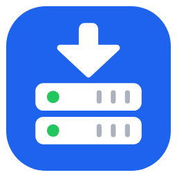
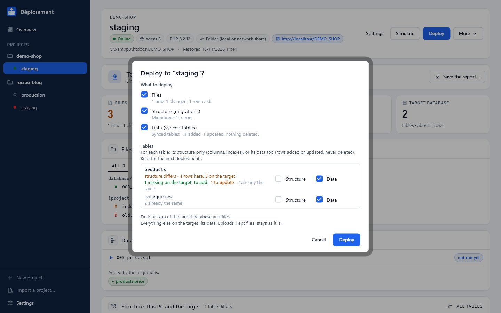
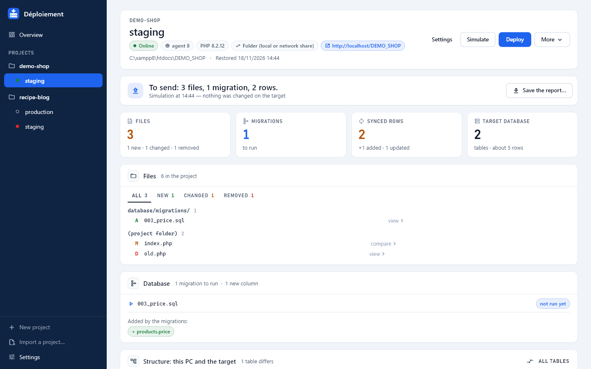
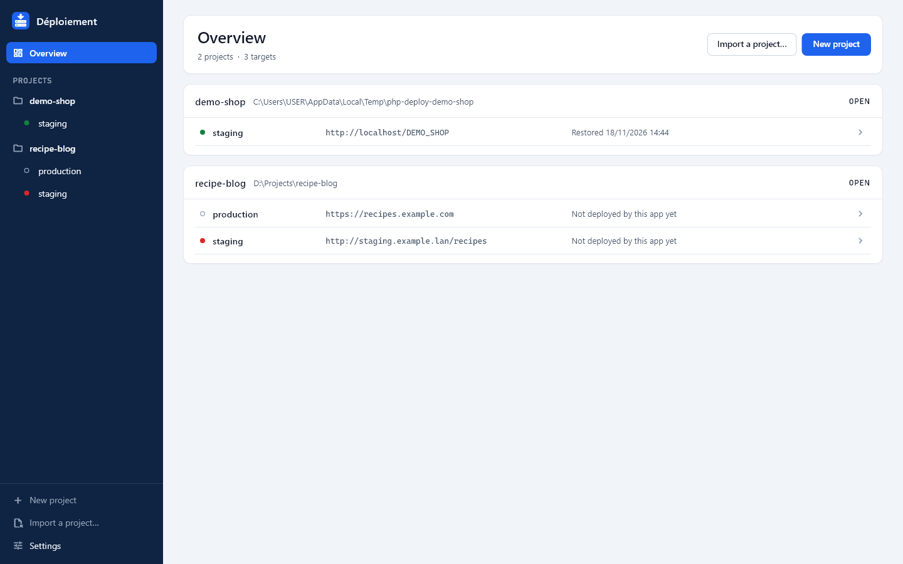
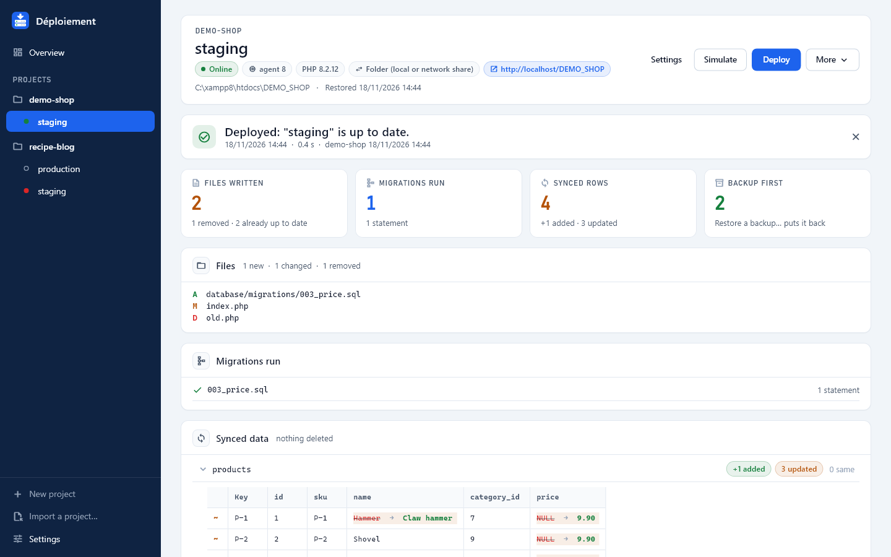
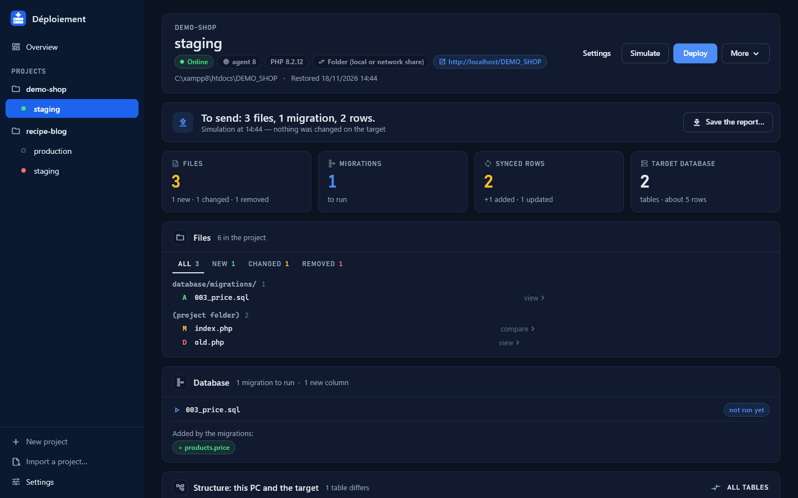

<p align="center"></p>

<h1 align="center">Déploiement</h1>

<p align="center">Deploy a PHP + MySQL project from your Windows PC to any server — shared hosting, a VPS, an office server —<br>
sending only what changed, with a backup before every change. No SSH needed.</p>

<p align="center"></p>

---

## Why

Updating a PHP site by hand means copying files by FTP, running SQL by hand in phpMyAdmin, and hoping nothing was
forgotten. I made Déploiement because these updates kept coming, and each one was the same slow, risky routine.
Now a deployment is: **Simulate** (see exactly what would change), then **Deploy**.

## What it does

- **Files** — only the files that differ from the server are sent (SHA-1 compared on both sides). Files you list as
  *kept* (`.env`, `uploads/`…) are never sent, overwritten nor deleted on the server.
- **Structure** — your SQL migrations run once on each server, recorded in a `_deploy_migrations` table. Or, table by
  table, the app makes the server's table like yours: table created, columns and indexes added, columns changed —
  never anything removed, no SQL to write.
- **Data** — for the tables you choose, rows are added or updated, never deleted. Rows are matched by a key
  (a unique index), never by their id; links to other tables are translated by the key of the row they point at.
  Big tables go step by step, and a cut connection resumes where it stopped.
- **Safety** — a simulation first, a backup of the server's database and files before every deployment,
  *Restore a backup…* to go back.
- **Transports** — FTP, FTPES, FTPS, SFTP, a Windows folder or network share, or an agent placed by hand.
- **More** — compare the databases of your PC and a server, run SQL on a server, clone a server to your PC,
  install a project on an empty server, send the code to a GitHub branch after a deployment, e-mail alerts when a
  server stops answering. English and French.

## How it works

The app places one small PHP file, the **agent** ([`assets/agent/deploy-agent.php`](assets/agent/deploy-agent.php)),
in the project folder on the server, under a random name. It obeys only the app: every request carries a secret key,
stored encrypted on your PC (Windows DPAPI). Everything happens on the server itself, so its database never has to
accept outside connections. The agent updates itself when the app brings a newer one.

<p align="center"></p>

## Video guide

A 90-second tour of the real app on a made-up shop: [English](docs/guide-en.mp4) · [Français](docs/guide-fr.mp4).

## Try it with the example

[`example/`](example) holds a tiny made-up recipe blog (PHP + MySQL) and its project file
[`recipe-blog.deploy.json`](example/recipe-blog.deploy.json): import it with **Import a project…** and deploy it to a
local folder served by XAMPP. See [`example/README.md`](example/README.md).

## Build

Windows 10 or 11, [Flutter](https://docs.flutter.dev/get-started/install/windows/desktop) 3.44 or later with the
Visual Studio "Desktop development with C++" workload.

```bash
flutter pub get
flutter build windows --release
```

The app is in `build\windows\x64\runner\Release\Deploiement.exe` (copy the whole folder).
To use it you need nothing else for sending files; PHP on the PC (XAMPP, Laragon, Wamp — found automatically) for
what touches the local database; Git for Windows for the GitHub part.

## Tests

`flutter test --update-goldens` (the screen tests write their captures in `test/captures`; they are not kept in Git). Most tests run alone; the end-to-end ones deploy to folders served by a local XAMPP (Apache and
MySQL started, installed in `C:\xampp8`) and remove what they created at the end.
The video guide is made from the screens of `test/generic_test.dart`, see [`tool/video`](tool/video/make_videos.ps1).

## Screens

<p align="center">



</p>

---

## En français

**Déploiement** envoie un projet PHP + MySQL de votre PC Windows vers n'importe quel serveur (hébergement
mutualisé, VPS, serveur du bureau) : seulement ce qui a changé, avec une sauvegarde avant chaque changement, sans SSH.
Une simulation montre d'abord tout ce qui changerait (fichiers, migrations, structure et données des tables choisies),
puis **Déployer** l'envoie. Pour chaque table : sa structure seule, ou aussi ses données (lignes ajoutées ou mises à
jour, jamais supprimées, reconnues par leur clé, jamais par leur id). Vidéo : [français](docs/guide-fr.mp4).
Pour essayer : [`example/`](example).

## License

[MIT](LICENSE) — © 2026 [faysal12369](https://github.com/faysal12369)
